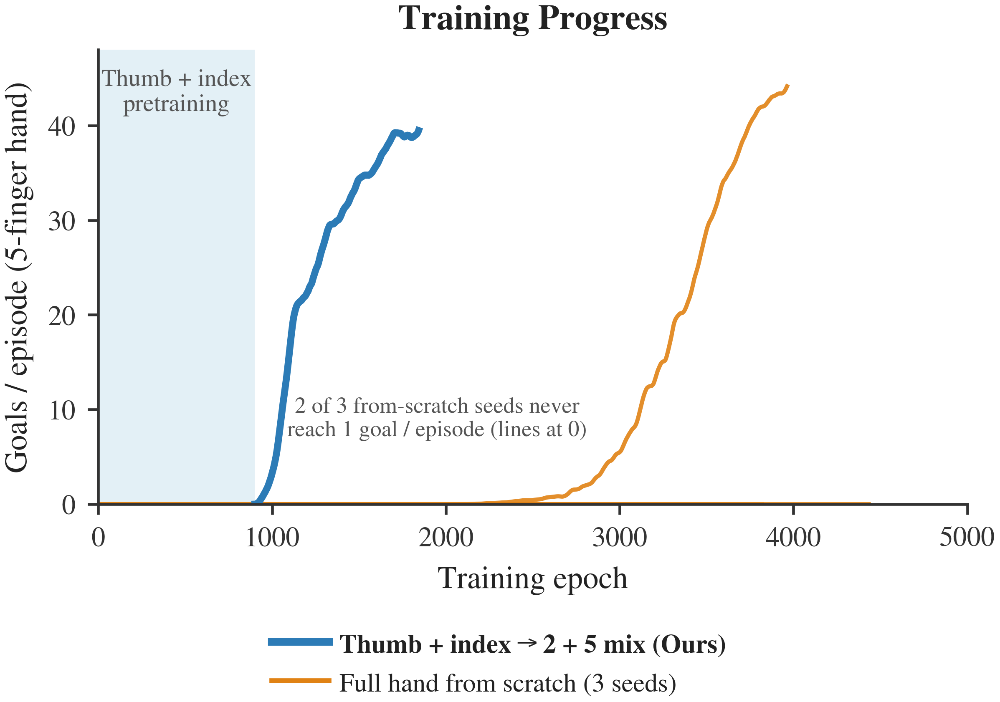

# Headline: a 2-finger policy unlocks the 5-finger hand

**Pen lift, Wuji v2 left hand on the dummy wrist.**

The setup:
- Train thumb + index first (joint transformer, 900 epochs).
- Fine-tune on a 2 + 5 finger mix (one env in two has each hand).

**Result.** The 5-finger hand reaches **35 goals/episode about 700 fine-tune epochs later, ~1,600 epochs in total**. Trained from scratch, the same network has **0 goals/episode at 1,500 epochs on all three seeds**.

The figure is `plots/embodiment_curriculum.png`.
- **To regenerate it:** `.venv_isaacsim/bin/python experiments/12oct_inhand_olympics/analysis/plot_embodiment_curriculum.py`. The numbers behind it go to `debug_outputs/inhand_olympics/embodiment_curriculum/embodiment_curriculum.json`.
- **What it shows:** the 5-finger hand's goals/episode against total training epochs, with the curriculum's 900 thumb + index epochs counted (shaded). Blue is the curriculum; orange is the same network (joint transformer) trained on the full hand from scratch, one line per seed. The full-hand MLP runs are in the table below, not the figure.
- **Smoothing:** a 25-epoch moving average, as in 08oct's training plots.

## The numbers (14 Oct)

All values are 5-finger goals/episode: training-time, leader SAPG block, 20-epoch mean (taken 14 Oct, before the figure moved to a 25-epoch mean). All runs use stagger and default pushes.

| 5-finger hand | at 1,500 epochs | at ~1,600 epochs | first epoch ≥ 1 goal/ep | latest |
|---|---|---|---|---|
| **Curriculum** (JT thumb + index s102 epoch 900 → 2 + 5 mix, job 264937) | – | **35.1** (~700 mix epochs) | within ~100 mix epochs | still rising |
| From scratch, JT s101 (257623) | 0.0 | 0.0 | 2,695 | 39.2 at 3,725 |
| From scratch, JT s102 (257624) | 0.0 | 0.0 | never (4,186 epochs) | 0.0 |
| From scratch, JT s103 (257625) | 0.0 | 0.0 | never (3,602 epochs) | 0.0 |
| From scratch, MLP s101 (256376) | 0.0 | 0.0 | never (4,969 epochs) | 0.0 |
| From scratch, MLP s102 (256377) | 0.0 | 0.0 | 3,655 | 18.9 at 4,989 |
| From scratch, MLP s103 (256378) | 23.8 | 29.7 | 944 | 43.4 at 4,978 |

- **Same architecture.** The joint transformer from scratch escaped on 1 of 3 seeds, after 2,695 epochs. Via thumb + index it learns at once.
- **Total compute.** At ~1,600 epochs the curriculum is ahead of every from-scratch full hand. That includes the best one, MLP s103 at 29.7.
- **5-finger experience.** The curriculum's 5-finger hand has had about 350 full-hand-only-epochs' worth of experience. Every from-scratch full hand is at 0 goals at that point.
- **How far from-scratch runs get.** The ones that escape end at 39–43. The curriculum reaches the same range several times sooner.

## What this does not show yet

- **One curriculum seed.** It started from the best thumb + index transformer, s102, which was chosen after seeing the results. Thumb + index JT s101 never learned. Repeat the curriculum from other thumb + index checkpoints at matched competence.
- **No mixture control.** A 5-finger-only fine-tune from the same epoch-900 checkpoint would separate "started from a 2-finger policy" from "trained alongside 2-finger envs".
- **Discovery, not ceiling.** On pen lift, thumb + index alone reaches 46–48 goals/episode, so 5 fingers have no room to do better at default pushes.
  - Under heavier pushes, thumb + index from scratch falls: 46 → 36.5 → 7.1 → 4.2 at 1×, 10×, 100× and 1000× force.
  - The mix fine-tunes at 10× and 100× show the 5-finger hand level with the 2-finger hand in the same mix so far: 20.8 vs 19.0, and 3.4 vs 3.5. Both runs are about 650 epochs in.
- **No intermediate steps.** The curriculum goes straight from 2 fingers to 5, with no 3- or 4-finger stage.

## Why from scratch fails (for context)

Before the first goal the episodes give almost no signal. Whether a run finds the pickup is close to chance (seed_test.md). Desynchronised episode clocks, on by default since 13 Oct, raised the thumb + index escape rate from 1/3 to 3/3. The full hand still escapes rarely. The thumb + index policy hands the 5-finger hand a grasp it already knows, so discovery is no longer the bottleneck.
