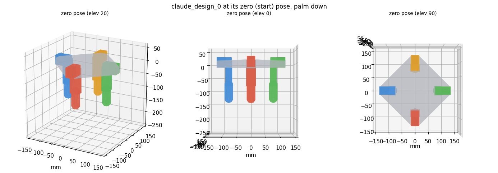
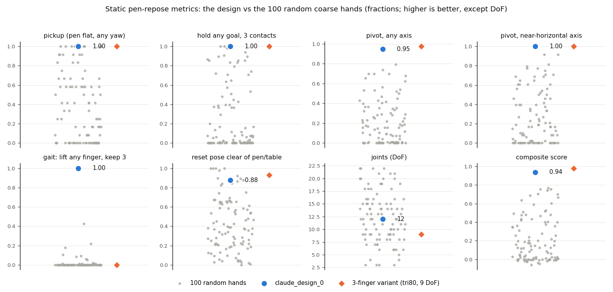
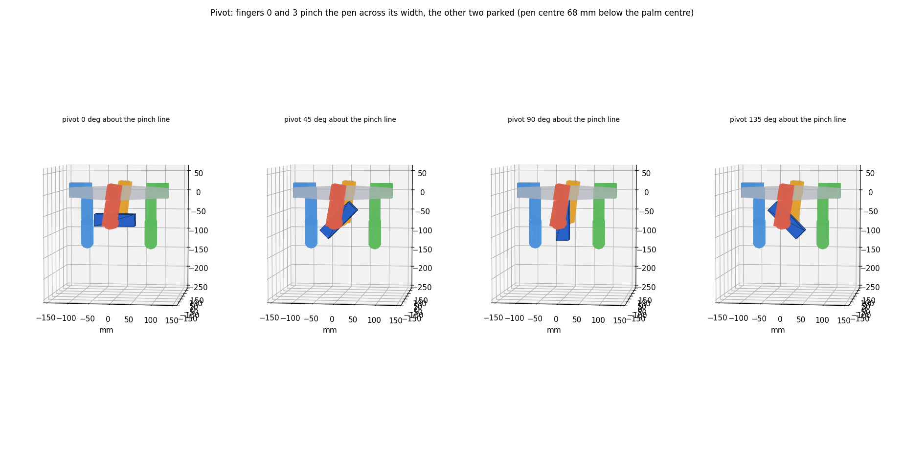
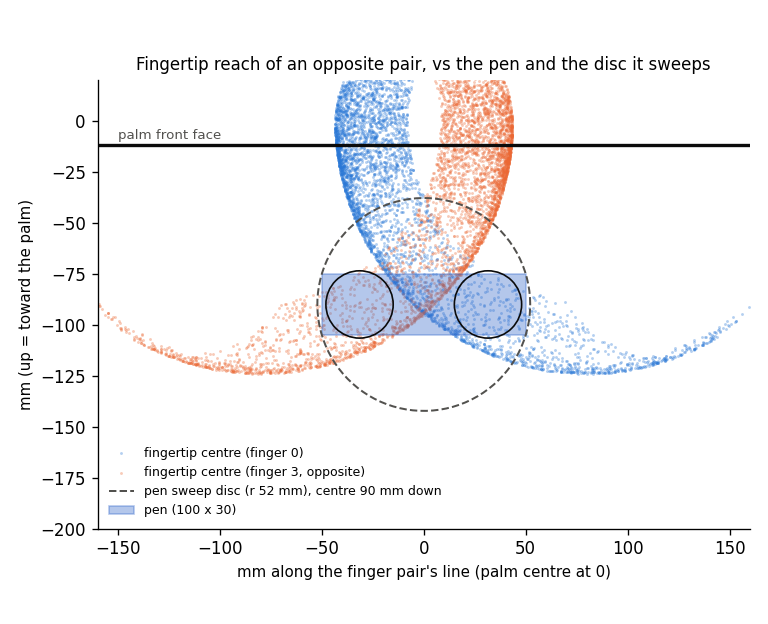

# claude_design_0: a hand designed for pen repose v2 (27 Oct)

**Spec:** `assets/urdf/27oct_grammar_claude_hands/claude_design_0/claude_design_0.spec.json`
(`HAND=<that path>` in the olympics env; built by `make_random.build`, so it has the shared dynamics: 0.5 N·m, 5 rad/s,
stiffness 3.0, 1750 kg/m³.)

**In one line:** four fingers in a cross, 80 mm out, pointing straight down from the palm. Each has a spread and a bend
crossing at the base (a knuckle), then a 70 mm link, a second bend and a 70 mm fingertip. That makes 12 DoF. It is a
4-finger D'Claw-style cage, wider than the pen's turning circle.

## The design

| Finger | Base (y, z) mm | Facing | Tilt | Joint 0 | Link 0 | Joint 1 | Link 1 | Joint 2 | Link 2 (tip) |
|---|---|---|---|---|---|---|---|---|---|
| f0 | (-80, 0) | 270 | 90 | spread (90, 0) | 0 mm | bend (0, 0) | 70 mm | bend (0, 0) | 70 mm |
| f1 | (0, -80) | 180 | 90 | spread (90, 0) | 0 mm | bend (0, 0) | 70 mm | bend (0, 0) | 70 mm |
| f2 | (0, 80) | 0 | 90 | spread (90, 0) | 0 mm | bend (0, 0) | 70 mm | bend (0, 0) | 70 mm |
| f3 | (80, 0) | 90 | 90 | spread (90, 0) | 0 mm | bend (0, 0) | 70 mm | bend (0, 0) | 70 mm |

- **No palm cut.** Each finger is 140 mm long (limit 225 mm).
- **Joint ranges:** spread ±30°, bends -30° to +90°. + closes toward the palm axis.
- **Joint motion at tilt 90:**
  - The spread swings the finger sideways (tangentially).
  - Both bends swing it radially in and out.
  - The 0 mm link puts the spread and the first bend on one point, like an MCP knuckle.
- **Checks:**
  - `hand.check(h, FEETECH_COARSE_RULES) == []`.
  - C1 holds.
  - C2 holds: best pair 0.34 mm apart, tolerance 20 mm.
  - The design is the output of `operators.canonical`.
- **Exporter check:** `verify_grammar_urdf.py` gives frame 3.6e-9 m, solid 6.2e-9 m, "specs load".

## Why this shape: what the task demands

1. **Only the long axis counts.** Success checks 4 keypoints along the pen's long axis, so its roll is free. Any change
   of the long axis is one rotation about an axis u perpendicular to both the old and new axes. For uniform goals, u
   is uniform on the sphere.
   - So the core skill is a **pivot**: pinch the pen across its 30 mm width with the pinch line along u, then swing it
     about that line.
   - The wrist can't rotate, so the fingers must be able to place that pinch line in any direction.
   - Turning about the pinch line, the pen sweeps a disc of radius √(50² + 15²) = 52.2 mm. Nothing may sit in that
     disc except the two pinching fingertips.
2. **Pick the pen up off the table at any yaw.** The wrist can't yaw, so the hand must pinch a 30 mm-high pen lying
   flat on the table in every orientation. That needs fingertips that reach *below* the palm down to table level.
   - Fingers in the plate's plane (tilt 0, the only option for a bend-first finger) must first curl 90° to point down.
3. **Hold it within the wrist's reach.** The wrist root goes no higher than 20 cm, and goals go up to 13.5 cm. So for
   high goals the pen's centre must sit within 65 mm of the palm centre, and fingers that only grip far below the palm
   lose those goals.
4. **Survive pushes while regrasping.** Pushes are about 0.6 N and twists about 0.06 N·m per step (1σ). A bare 2-finger
   pinch spins freely about its own axis. Gaiting without dropping to two contacts therefore needs a pinch, a third
   contact, and a fourth finger free to move: at least 4 fingers.
5. **Few joints and short links.**
   - RL sample efficiency favours fewer DoF.
   - The links here weigh 100-130 g each, with stiffness 3 N·m/rad and a 0.5 N·m cap. Shorter links mean less
     inertia and more fingertip force.
   - At reset the wrist sits at 15 cm with every finger joint uniform over its range and the pen under the palm. A
     finger longer than about 135 mm pointing down hits the table or the pen.

The design answers each demand in turn:

- **Fingers pointing down (tilt 90).** These need a non-bend first joint; here it is a spread. The fingertips start
  over the table, and the bends move them radially in and out in a vertical plane.
- **Four fingers at 80 mm in a cross.**
  - The clear cage under the palm has a radius of 63.5 mm: the closest any finger solid comes to the palm axis at the
    zero pose. That exceeds the pen's 52.2 mm turning radius, so the pen can turn about any horizontal axis, or spin
    in yaw, inside the cage while the two non-pinching fingers stand clear.
  - At 40 mm the cage is too tight: the pivot score drops to 0.64.
  - The 90° symmetry matches the random pen yaw (the 14-15 Oct cross argument). Opposite pairs give pinch lines at 0°
    and 90°, and the ±30° spread fills in between.
- **Links 0/70/70.** Every fingertip reaches the palm axis (within 1-2 mm) at every depth from 30 to 110 mm below the
  palm. A centred pinch needs 31.5 mm. The tips reach 124 mm below the palm, and 52 mm *above* the palm face when bent
  back.
  - The longest point at the zero pose is 140 mm below the root, which leaves 10 mm above the table at reset. Longer
    fingers lose reset clearance (below).
- **Pinch force.** At the horizontal pivot pose (pen centre 68 mm below the palm centre), each pinching fingertip can
  press inward with 6.7-6.9 N within the 0.5 N·m effort cap. The pen weighs 0.29 N.

## How I measured it (`agent_design/pen_metrics.py`)

Each finger is sampled 12,000 times uniformly over its own joints. For each sample I keep its fingertip sphere (r 16.5
mm) and points along every link with the link's half-thickness. A target counts as reached if a sample puts the tip
within 6 mm of it, with no link inside the pen (3 mm soft slack) and nothing below the table. The fingers that are not
gripping must also be able to **park**: some pose of theirs clears the pen, or its swept disc, and the table.

| Metric | Definition |
|---|---|
| `pickup` | Pen flat on the table, 12 yaws over 0-165°. Two fingers pinch it across its width (or end to end) for some wrist position, palm above the pen, no link below the table, the others parked. |
| `hold3` | 96 task goals (uniform orientation; height uniform from the floor to 13.5 cm). Pinch plus a third contact, the rest parked, at that height within the wrist's limits (root ≤ 20 cm), for any pen roll. |
| `pivot` | 96 axes u, uniform on the sphere. Two fingers pinch the pen's centre along u; their links and every other finger stay out of the full swept disc; the disc clears the palm and the table within the wrist's range. |
| `pivot_h` | `pivot` restricted to axes within 30° of the palm plane: end-over-end flips. |
| `gait_all` | For the goals: at one held pose, *each* finger in turn can lift off and park while the other three keep pinch plus third contact. Needs at least 4 fingers. |
| `reset_clean` | Probability that the env's reset pose has no link in the pen or the table. |
| `score` | 0.2 pickup + 0.3 hold3 + 0.4 pivot + 0.1 pivot_h − 0.01 per joint beyond 8. This was the search objective; gait and reset were added as separate terms. |

Approximations:

- Fingers are checked one at a time. I never check finger-finger or finger-palm collisions.
- Contact only counts through the tip sphere.
- Fingers beyond a palm cut may use different hinge angles in a pair. This **over-credits palm cuts**.
- Three sampling seeds give identical results to ±0.01 on this design.

## Numbers: the design vs the 100 random hands (`assets/urdf/27oct_grammar_random_hands/`)

| Metric | claude_design_0 | Random mean | Random median | Random max | Best random by score (coarse_s0_039) | Random ≥ design |
|---|---|---|---|---|---|---|
| pickup | **1.00** | 0.37 | 0.25 | 1.00 | 1.00 | 10 of 100 |
| hold3 | **1.00** | 0.25 | 0.06 | 1.00 | 1.00 | 2 of 100 |
| pivot (any axis) | **0.95** | 0.20 | 0.15 | 0.79 | 0.68 | 0 |
| pivot_h (flips) | **1.00** | 0.26 | 0.17 | 0.92 | 0.77 | 0 |
| gait_all | **1.00** | 0.01 | 0.00 | 0.43 | 0.05 | 0 |
| reset_clean | 0.88 | 0.43 | 0.38 | 1.00 | 0.24 | 9 of 100 |
| DoF | 12 | 12.4 | 12 | 22 | 16 | - |
| score | **0.94** | 0.21 | 0.13 | 0.77 | 0.77 | 0 |

- **No random hand matches or beats the design on every metric.** The best random hands by score are 13-22 DoF, mostly
  with palm cuts, and are poor on reset (0.02-0.43).
- **Only 35 of the 100 random hands have any downward-pointing finger, and none has more than two.** A tilt-90
  finger needs a spread or twist first joint (about 31% of draws) and the top tilt (1 of 4). So this design family is
  close to unreachable by random sampling.
- **Pivot failures:** the 5% of axes it misses all lie more than 60° from the palm plane (67-84°), i.e. yaw spins of a
  flat pen. Covered there: 62% of axes. Covered within 60° of the plane: 100%.
  - A yaw change can instead be made as two flips through vertical, or by pushing the pen round inside the cage.

## How I got here (search)

- **Grid (`grid.py`, 311 valid hands):**
  - Layouts: cross at 40 and 80 mm, diagonal, 3-finger, pair, 5-finger and 6-finger.
  - Tilts 0, 60 and 90. Every tilt-60 hand failed C1.
  - Chains of 2-4 joints, several lengths each.
  - The best hand of each family:

  | Family | pickup | hold3 | pivot | pivot_h | reset | DoF | score |
  |---|---|---|---|---|---|---|---|
  | Planar cross at 80 (tilt 0, bend-bend-bend 30/60/50: the 15 Oct primitive-hand shape) | 0.83 | 0.77 | 0.06 | 0.06 | 0.96 | 12 | 0.39 |
  | Best planar (tilt 0) of any layout | 1.00 | 0.23 | 0.58 | 0.97 | 0.32 | 9 | 0.59 |
  | Downward cross at 40 | 1.00 | 0.88 | 0.64 | 1.00 | 0.35 | 12 | 0.78 |
  | Downward cross at 80, 50/50/50 | 1.00 | 1.00 | 0.88 | 1.00 | 0.74 | 12 | 0.91 |
  | 5 or 6 downward fingers | 1.00 | 1.00 | 0.97-0.98 | 1.00 | 0.03-0.04 | 15-18 | 0.89-0.92 |

  - Planar fingers can only pinch along lines inside their own curl planes, so they cannot pivot about most axes.
- **Length sweep (`sweep_cross.py`):** 159 hands, downward cross at 80 and 3-finger at ~120°, spread- or twist-first,
  every allowed link triple.
  - 0/70/70 is the best 4-finger hand that keeps reset clear: pivot 0.92 at 64 axes.
  - Longer fingers gain a little pivot but lose the reset:
    - 50/50/70: pivot 0.95, reset 0.15.
    - 0/90/70: pivot 0.94, reset 0.44.
  - Shorter fingers keep the reset but lose the pivot:
    - 0/50/70: pivot 0.81.
    - 0/90/30: pivot 0.72.
  - Spread-first beats twist-first at equal lengths. The best twist-first hand is 50/70/30: pivot 0.86, reset 0.79.
- **Hill climbing with the grammar's own operators (`search.py`, `operators.mutate` under the coarse rules, C2
  required):**
  - Two chains with my score and no gait term both converged on 3-finger downward hands at 80-90 mm. That
    independently confirms the "downward fingers on a wide ring" shape.
  - Three chains with the gait term, two of them started at this design, found nothing better outside the metric's
    noise (about ±0.02). The few slightly higher children either broke the 4-fold symmetry or added a palm cut (+1
    DoF), which my metric over-credits.

## Alternatives I rejected

- **The 3-finger version (tri80, 0/70/70, 9 DoF).** It is equal or slightly better on every static metric (pivot
  0.98, reset 0.93, score 0.98), but **gait = 0** by construction. Every regrasp drops it to a bare 2-finger pinch,
  which turns freely under the env's 0.06 N·m twists, and touching the table after the pickup ends the episode.
  - Over 50 goals per episode, a hand that can regrasp on three contacts should drop the pen less. That is worth 3
    more joints.
  - **This is the closest call in the design. If one extra run is affordable, train tri80 alongside it.**
- **5-6 downward fingers.** No static gain (the metrics are already saturated). They cost 15-18 DoF, and the
  wide-angle versions hit the table and pen at reset.
- **Fingers in the palm plane (tilt 0), the primitive-hand shape.** Pivot 0.06. Those hands did reach about 30
  goals/episode on 15 Oct, but with a 10 cm palm disc, 20 mm fingers and links free of motor floors. Under the Feetech
  rules the palm is about 25 cm across with 33 mm fingertips, and planar fingers spend their whole reach curling down
  to the pen.
- **Longer fingers.** A slightly higher pivot score, but they reach the table (and the pen) at reset, weigh more and
  push weaker.

## Caveats

- **Static analysis only.** None of this has been trained. The metrics show the hand *can* pick up, hold, pivot and
  gait; whether SAPG finds those motions is untested. Per the earlier single-seed experience (Shadow 42 vs 0 on
  identical runs), compare it against the random picks with at least 2 seeds.
- **Heavy fingers.** The fingers total 1.33 kg (links of 98, 127 and 106 g), because the grammar's links are
  servo-sized boxes. Robot gravity is off in this env, so this costs inertia, not load.
- **Little palm contact.** The palm is not a useful contact surface: holds use fingertips only. That suits palm-down
  manipulation but differs from the 15 Oct hands.
- **Collisions not modelled.** Finger-finger and finger-palm collisions are not in the metric. At the renders' poses
  nothing intersects (see `plots/agent_design/design_pivot.png` and `design_pickup.png`).

## Files

- `agent_design/`:
  - `pen_metrics.py`: the metrics.
  - `designs.py`: spec helpers.
  - `grid.py`, `sweep_cross.py`, `search.py`: the search; results in `grid_metrics.json`, `sweep_cross.json`,
    `search_*.jsonl`.
  - `eval_random.py`, `gait_random.py`: the 100 random hands; results in `random_metrics.json`, `random_gait.json`.
  - `analyze_design.py`: writes `final_metrics.json` and the plots.
  - `export_design.py`: the URDF export.
  - `render.py`: matplotlib renders.
- `plots/agent_design/`:
  - `design_views.png`
  - `design_pivot.png`: pinch-and-flip sequence at 0/45/90/135°.
  - `design_pickup.png`: pinch of a flat pen at 30° yaw.
  - `workspace_pair.png`: an opposite pair's reach against the pen and its sweep disc.
  - `compare_random.png`
- `assets/urdf/27oct_grammar_claude_hands/claude_design_0/`: `.urdf`, `.spec.json`, `.design.json`, palm and mount
  meshes.

